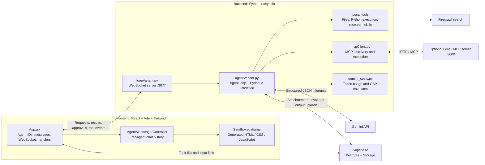

# AgentSystem

A full-stack AI agent prototype that turns a user request into a sequence of tool calls, observations, and a completed result. Users can run separate agent conversations, approve tool actions, provide follow-up information, receive generated files, and interact with model-generated HTML/CSS/JavaScript components.

The project implements its agent loop directly in Python, with a React interface over WebSockets. Gemini is the default inference provider; an optional Ollama path is also present. This is a local development prototype with explicit extension points for tools, MCP servers, and execution environments.

## Architecture



### Frontend responsibilities

- **`web-app/src/App.jsx`** owns agent IDs, per-agent message state, draft messages, attachments, and the WebSocket connection. It uploads user files to Supabase and sends their metadata to the backend.
- **`web-app/components/AgentMessengerController.jsx`** receives the full message array for one agent, maps messages to the appropriate JSX, and scrolls that chat to the bottom using the DOM's `scrollTop` and `scrollHeight`.
- **`modal.jsx` and `AskFurtherInformation.jsx`** provide tool approval and follow-up input controls. State-update handlers live in `App.jsx` and are passed down as props.
- **`web-app/frontendTools/tools.js`** contains browser tools such as geolocation. The backend requests these tools through WebSocket events, and the browser returns the result.
- **Custom UI** is rendered through an iframe's `srcDoc`, with `sandbox="allow-scripts"`. Generated JavaScript can run inside the frame without enabling same-origin access to the parent app.

### Backend responsibilities

- **`loopVariant.py`** is the application entry point. It runs the WebSocket server, maintains the in-memory agent registry and message history, and routes user messages and interaction responses.
- **`agentVariant.py`** defines the agent, prompts, Pydantic response models, local tools, model calls, validation retries, and the execution loop. It dispatches actions, appends observations, and returns completed results.
- **`gemini_helper.py`** downloads user attachments from Supabase URLs and uploads them to the Gemini Files API. The backend includes those Gemini file references in inference requests.
- **`supabase_helpers.py`** uploads generated files under `outputs/` in Supabase Storage and returns public URLs for the frontend.
- **`mcpClient.py`** discovers external tools and calls them through MCP. Server URLs are configured in `mcp.json`.
- **`gemini_costs.py`** reads inference usage metadata, calculates input/cached/candidate/thinking token estimates, prints them, and appends them to `gemini_costs.json` in GBP.
- **`SKILLS/`** contains Markdown instructions discovered at runtime and exposed to the agent through skill-reading tools.

## How a request runs

1. The frontend creates an `agent_id` and saves it in Supabase's `agent_id_table`. Each user request gets a separate `message_id`.
2. The frontend sends the request and optional attachment metadata over WebSocket. The backend creates an `Agent` instance or reuses the existing instance for that ID.
3. A run receives a new `session_id`. The backend filters shared message memory by `agent_id` and builds the model's context and structured-output schema.
4. Gemini returns JSON describing either tool actions or a completed result. Pydantic validates the response locally, including its request ID and output structure.
5. The backend executes local, browser, or MCP tools. Approval-required calls pause on an `asyncio.Future` until the user responds. Tool observations feed the next inference step.
6. A completed result is either text with optional files, or a custom UI component. Generated file attachments are uploaded to Supabase before the result is sent back.
7. The frontend appends the event to that agent's chat. Earlier responses and interactive components remain in the conversation.

An existing agent is reused between requests, preserving its configuration and in-memory context. If it is already running, new input is appended for a subsequent step; otherwise a new run is scheduled. This is in-process coordination, not a durable job queue.

### Structured model response

The core `LLMAgentResponse` fields are:

| Field | Purpose |
| --- | --- |
| `rationale` | A brief explanation of the selected next action. |
| `message_id` | The existing user-request UUID being answered. |
| `actions` | Local, browser, or MCP tool calls; null or empty when returning a result. |
| `result` | Either `FinalAnswer`, `CustomUI`, or null while tools are needed. |

The result union has two mutually exclusive shapes:

```json
{"type": "final_answer", "answer": "Your report is attached.", "files": []}
```

```json
{"type": "custom_ui", "html": "<button>Flip card</button>", "css": "button { padding: 16px; }", "js": "/* component interaction */"}
```

Pydantic rejects mixed result shapes and responses containing both actions and a completed result. File attachment paths use `FilePath`, which verifies local existence, not the validity of the file's contents. Schema-validation feedback can be sent to the model for another attempt; transport errors are a separate failure category.

### WebSocket events

The backend currently uses `ws://localhost:3077`. Completed results are JSON-encoded in the `agent_response` field of a `task_result` envelope; the frontend parses the outer event and then that result.

| Event | Direction | Purpose |
| --- | --- | --- |
| User request | Browser ? backend | `agent_id`, `message_id`, `user_message`, optional `files`. |
| `task_result` | Backend ? browser | Completed answer/files or custom UI in `agent_response`. |
| `function_call` | Backend ? browser | Tool execution updates and observations. |
| `task_error` | Backend ? browser | Backend exception text in `agent_error`. |
| `human_in_loop_request` | Backend ? browser | Tool approval request with a `request_id`. |
| Approval response | Browser ? backend | `human_in_loop_response: true`, matching IDs, and a boolean `result`. |
| `human_input_request` | Backend ? browser | A follow-up question; answering submits another user message. |
| `client_side_tool_call` | Backend ? browser | Browser-tool invocation with its name, arguments, and call UUID. |
| Browser-tool response | Browser ? backend | Matching call ID, result or error, and `frontend_tool_call: true`. |

## Local setup

### Prerequisites

- Python **3.12** is the development baseline.
- Node.js **22 or newer** and npm. The installed Supabase JS dependency requires Node 22+.
- A Gemini API key, Firecrawl API key, and a Supabase project.
- Optional: Google OAuth credentials for Gmail MCP, or a local Ollama installation.

Use your own credentials and a dedicated demo project. Create the configuration files below locally; do not copy someone else's `.env`, OAuth client-secret file, or OAuth token.

### 1. Configure backend environment variables

Create **`.env` in the repository root**:

```dotenv
GEMINI_API_KEY=your_gemini_api_key
FIRECRAWL_API_KEY=your_firecrawl_api_key
SUPABASE_URL=https://your-project.supabase.co
SUPABASE_SERVICE_ROLE_KEY=your_supabase_service_role_key
```

| Variable | Used by | Requirement and handling |
| --- | --- | --- |
| `GEMINI_API_KEY` | Google GenAI SDK, through `genai.Client()` | Required for the default Gemini agent and uploaded-file handling. Obtain a Gemini Developer API key from Google AI Studio. Backend secret. |
| `FIRECRAWL_API_KEY` | `Firecrawl(...)` in `agentVariant.py` | Used for web research. The client is instantiated when the module loads, so configure it for the current default setup. Backend secret. |
| `SUPABASE_URL` | `supabase_helpers.py` | Your Supabase project URL. Required by the backend storage client. |
| `SUPABASE_SERVICE_ROLE_KEY` | `supabase_helpers.py` | Backend-only key for generated-file uploads; bypasses RLS. Never put it in a `VITE_` variable. |

`load_dotenv()` runs during backend startup. The Google SDK also supports `GOOGLE_API_KEY`; use one Gemini credential variable consistently. If an API-version mismatch affects a preview model, `GOOGLE_GENAI_API_VERSION=v1beta` can explicitly select that route in the current SDK.

The current model ID, `gemini-3.5-flash-lite`, is configured in the inference and optional review calls in `agentVariant.py`. There is no model-selection environment variable wired into this repository. Verify access with your own account; model availability can change.

### 2. Configure frontend environment variables

Create **`web-app/.env`**:

```dotenv
VITE_SUPABASE_URL=https://your-project.supabase.co
VITE_SUPABASE_ANON_KEY=your_supabase_anon_key
```

These are read by `web-app/supabase/supabase.js`. Use the **same Supabase project** as the backend. `VITE_SUPABASE_ANON_KEY` is the browser-facing anon key, not the service-role key. All `VITE_` variables are bundled into browser code, so access must be controlled by Supabase policies. Restart Vite after changing this file.

No Gemini, Firecrawl, Render, or Gmail secret belongs in frontend configuration. The WebSocket URL is currently a constant in `App.jsx`, not an environment variable.

### 3. Set up Supabase resources

Create the table expected by `App.jsx`:

```sql
create table public.agent_id_table (
  agent_id uuid primary key
);
```

Create a **public Storage bucket named `agent_files`**. The current application uses public URLs for uploads and downloads:

| Resource | Required access |
| --- | --- |
| `public.agent_id_table` | Browser role needs `INSERT` and `SELECT`, including the inserted row returned by `.insert(...).select()`. |
| `agent_files/inputs/` | Browser role needs Storage `INSERT` access for user attachments. Scope policies to this bucket and input prefix. |
| `agent_files/outputs/` | Backend service-role client uploads/upserts generated files here. |
| Public file URLs | Used for downloading attachments and retrieving user files for Gemini. |

Configure the corresponding grants and RLS/Storage policies in your own project. The prototype has no user sign-in or ownership model, so browser requests currently use the anon role. Use non-sensitive demo files: a public bucket is not private document storage. The app stores task IDs and files in Supabase; it does **not** currently persist or restore chat history there.

### 4. Install and run the backend

From the repository root, in PowerShell:

```powershell
python -m venv venv
.\venv\Scripts\Activate.ps1
python -m pip install -r requirements.txt
python loopVariant.py
```

The server should print `websocket server listening on 3077`. Keep that terminal open. Run from the repository root so relative paths resolve consistently.

For spreadsheet-generation tasks, also install:

```powershell
python -m pip install openpyxl
```

`openpyxl` is not currently listed in `requirements.txt`; other generated scripts may need additional packages. The `run_python` tool uses the backend interpreter for Python scripts. A text file renamed to `.xlsx` or `.pdf` is not a valid workbook or PDF: these formats need appropriate generation libraries.

### 5. Install and run the frontend

In a separate terminal:

```powershell
cd web-app
npm ci
npm run dev
```

Open the local URL printed by Vite, normally `http://localhost:5173`. Create a task card and send a message. Each card maintains its own chat history and scroll position updates.

To check the production frontend build:

```powershell
npm run build
```

### 6. Optional Gmail MCP integration

The Gmail server exposes `search_emails` and `read_email` through FastMCP. Its dependencies and OAuth setup are separate from Gemini credentials.

1. In your Google Cloud project, enable the Gmail API and create an OAuth **Desktop app** client. Configure the consent screen and add your account as a test user if required.
2. Download the OAuth client JSON into `mcpServer/`. Update `CLIENT_SECRET_FILE` in `mcpServer/get_google_auth.py` to point to your downloaded file. This is currently a file-path constant, not an environment variable.
3. Authenticate and start the server from another terminal:

   ```powershell
   .\venv\Scripts\Activate.ps1
   python -m pip install -r mcpServer/requirements.txt
   cd mcpServer
   python get_google_auth.py
   fastmcp run server.py:mcp --transport http --host 127.0.0.1 --port 8000
   ```

4. Complete the browser consent flow. The helper requests `gmail.readonly` and saves a refreshable credential in `mcpServer/token.json`.
5. Keep the endpoint in `mcp.json` as `http://127.0.0.1:8000/mcp`, then create a new agent so it discovers the tools.

Protect both the OAuth client JSON and `token.json`. The latter represents access to the consenting user's mailbox. Importing the current authentication helper also runs credential initialization.

For a demo without MCP, set `"mcpServers": {}` in `mcp.json`. The agent can then use its local and browser tools without Gmail credentials.

### Optional Ollama path

The agent has a text-only Ollama branch selected by `self.model_provider = "ollama"`, with `qwen2.5:3b` as its current model. Run Ollama locally and pull that model before selecting this branch. This is a code setting, not an environment switch. Uploaded-file handling and file-based review currently depend on Gemini. Supabase and Firecrawl clients are still initialized by the current backend modules.

## Engineering decisions and current limits

| Area | Implementation and trade-off |
| --- | --- |
| Agent orchestration | An explicit Python loop makes prompts, validation, tool dispatch, and observations inspectable. Agents can be scheduled concurrently, while actions within a step are executed in sequence. |
| Output contracts | Pydantic validates structured responses and separates final answers from custom UI. Validation cannot establish factual correctness or verify a binary file's format. |
| Human interaction | Request IDs and futures correlate approval/browser-tool responses. Follow-up input resumes work through the normal message path. |
| Conversation state | Agent instances and backend history live in process memory; frontend history lives in React state. Restarting the backend or refreshing the browser loses that layer's state. |
| Execution | `run_python` executes local subprocesses with a timeout and captures stdout/stderr. It is **not sandboxed** and may block the event loop. Render or another remote sandbox is a proposed extension, not implemented. |
| Files | Generated files currently share the project directory; uploads use `outputs/<filename>` and can overwrite the same storage path. Per-task workspaces and artifact validation would improve isolation. |
| Networking | Some helpers perform synchronous I/O inside async workflows. Connection resets/SSL errors need transport-specific handling; schema retries alone do not recover them. |
| Client isolation | The WebSocket server uses a shared `current_ws` reference. It is a local single-client prototype, not a production multi-user router. Authentication, per-user authorization, and secure deployed transport are not implemented. |
| Cost reporting | Usage is logged to `gemini_costs.json` in GBP, using a fixed exchange rate. The helper currently labels/prices calls as Gemini 3 Flash Preview while inference uses Gemini 3.5 Flash-Lite; update those constants before treating totals as accurate. |
| Dependencies and operations | Python requirements are unpinned, and the repository includes development artifacts. Reproducible dependency locks, automated regression checks, durable state, and deployment configuration are future work. |

The main next steps are isolated code execution, persistent conversations, authenticated client routing, format-aware artifact validation, and model-aware cost accounting.

## Credentials and repository hygiene

Keep real API keys, `.env` files, OAuth client files, and OAuth tokens out of commits. `.gitignore` does not untrack files already committed. Before sharing a fork, check tracked configuration files and history; replace exposed credentials with newly issued ones. Supply placeholder configuration to reviewers rather than existing local secrets.

No Render credentials are required for the current implementation. If remote sandboxes are added later, their credentials should remain in the backend, with only task inputs passed into the execution environment.
